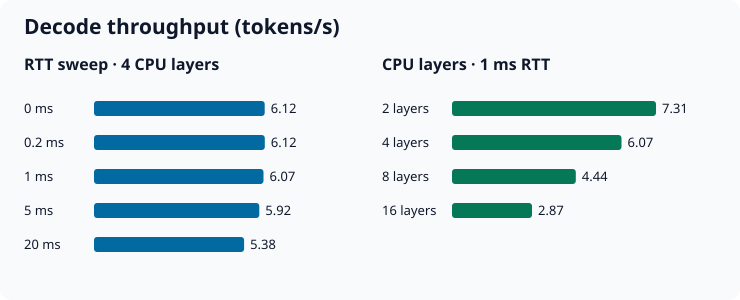

# EXAONE 4.5 33B CPU–GPU 분할 추론

## 환경

| 항목 | 확인값 |
|---|---|
| 서버 | 단일 Vast.ai 컨테이너, Ubuntu 24.04.5 LTS, Linux 5.15.0-198-generic |
| CPU | AMD EPYC 7K62, 물리 48코어·논리 96스레드, 컨테이너 CPU 쿼터 약 30.72코어 |
| RAM | 호스트 표시 503 GiB, 컨테이너 한도 약 279 GiB |
| GPU | NVIDIA GeForce RTX 4090, 24,564 MiB, 초기 1 MiB·0% 사용 |
| CUDA | 드라이버 615.71.09, 드라이버 및 설치 툴킷 CUDA 13.4, PyTorch 휠 CUDA 12.8 |
| Python 및 모델 구현 | Python 3.12.16, PyTorch 2.10.0+cu128, Transformers 5.20.0 |
| 저장장치 | 시작 시 오버레이 여유 약 298 GiB |
| 체크포인트 | 공식 BF16 safetensors 두 샤드, 인덱스 기준 68,700,195,328 B |

## 모델과 양자화

공식 `Exaone4_5_ForConditionalGeneration`에서 텍스트 백본은
`model.language_model`의 `Exaone4Model`이다. 원본의 `exaone4_5_text`
설정은 Transformers에서 `exaone4`로 정규화된다. 64개 레이어의 폭은
5120이며 쿼리 헤드 40개와 KV 헤드 8개를 사용한다. 4096 토큰의 슬라이딩
어텐션 3개 뒤에 글로벌 어텐션 1개가 오는 패턴이 반복된다. 슬라이딩
레이어는 Llama 3 방식으로 스케일링한 1D RoPE를 적용하고, 글로벌 레이어는
위치 회전을 생략한다. 최상위 `tie_word_embeddings=false`와 체크포인트
인덱스의 두 키를 확인해 별도 임베딩과 LM Head 가중치를 적재했다.
비전 인코더와 MTP는 분할 텍스트 생성 경로에서 생략한다.
[공식 모델 설정](https://huggingface.co/LGAI-EXAONE/EXAONE-4.5-33B/blob/main/config.json)
· [Transformers 텍스트 구현](https://github.com/huggingface/transformers/blob/v5.20.0/src/transformers/models/exaone4/modeling_exaone4.py)
· [멀티모달 래퍼](https://github.com/huggingface/transformers/blob/v5.20.0/src/transformers/models/exaone4_5/modeling_exaone4_5.py)

GPU는 공식 BF16 체크포인트에서 레이어를 하나씩 읽어 Linear를 bitsandbytes
NF4로 변환한다. NF4는 정규분포에 맞춘 코드북을 쓰고 BF16으로 연산하며
추가 양자화로 블록 스케일을 압축한다. AWQ는 보정 데이터의 활성값을
활용하고 사전 양자화된 체크포인트와 호환 커널을 사용한다. 공식 AWQ
체크포인트도 제공된다. 이 실험은 동일 BF16 체크포인트에서 CPU 가중치를
그대로 사용하고 GPU 레이어만 개별 변환할 수 있는 NF4를 선택했다.
[bitsandbytes](https://huggingface.co/docs/transformers/en/quantization/bitsandbytes)
· [AWQ](https://huggingface.co/docs/transformers/en/quantization/awq)
· [공식 AWQ 체크포인트](https://huggingface.co/LGAI-EXAONE/EXAONE-4.5-33B-AWQ)

## 구현과 수정

- CPU는 채팅 템플릿과 토큰화, 임베딩, 레이어 0–3, 최종 RMSNorm, LM Head,
  greedy 토큰 선택과 디코딩을 실행한다. GPU는 레이어 4–63을 실행한다.
- CPU에서 GPU로 프리필 전체 또는 디코드 한 토큰의 hidden state를 전송한다.
  GPU는 CPU의 LM Head에 필요한 마지막 위치 hidden state를 반환한다.
  레이어 가중치와 KV 텐서는 각 프로세스에 유지된다.
- 마스크와 레이어 호출에 Transformers 5.20의 `past_key_values`를 전달한다.
  각 샤드의 DynamicCache는 로컬 순서로 구성하고 체크포인트와 어텐션 유형은
  글로벌 레이어 번호로 선택한다. GPU 마스크가 CPU의 빈 캐시 슬롯을 참조하던
  문제가 해결되며 분할점이 슬라이딩 패턴 중간에 있어도 동작한다.
- BF16을 FP16으로 바꾸던 전송 경로를 BF16 비트 패턴을 보존하는 16비트
  프레임으로 바꿨다. 서버는 세션 초기화, 분할점, 위치, 텐서 크기를 검사하고,
  오류나 연결 종료 시 해당 세션의 캐시를 제거한다.
- 벤치마크는 모델 초기화 이후의 프리필·TTFT, 두 번째 토큰부터의 처리율,
  CPU/GPU 연산, PCIe 복사, TCP RPC, 애플리케이션 지연 및 프레임 바이트를
  수집한다. CPU 시간에는 임베딩·앞단 레이어와 최종 헤드·greedy 선택이 포함된다.
  TCP·프레임 시간은 RPC에서 서버 측 GPU 실행과 PCIe 복사를 뺀 값이다.
  전송량은 애플리케이션 프레임 기준이며 TCP/IP 헤더와 제어 메시지는 제외한다.

## 측정 결과

배치 1, Python CPU 연산 스레드 8개, 조건당 3회. 공개 질문은 “대한민국의 수도는 어디인가요? 한 문장으로 답하세요.”이다. 표의 ±는 표본 표준편차다. GPU 기준선은 공식 멀티모달 래퍼를 NF4로 적재한 텍스트 입력 실행이다. 분할 실행에서 프리필은 hidden state 반환까지, TTFT는 CPU LM Head와 첫 토큰 선택까지 측정했다. GPU 기준선은 공식 forward가 LM Head를 포함한다. 모델 로딩, 토큰화 및 TCP 연결 초기화는 제외했다.

| 경로 | CPU 층 | RTT ms | Gbps | n | 프리필 ms | TTFT ms | 디코드 토큰/s |
|---|---:|---:|---:|---:|---:|---:|---:|
| GPU-only | 0 | — | — | 3 | 98.11 ± 1.41 | 98.17 ± 1.41 | 13.39 ± 0.05 |
| 프로세스 내부 | 4 | 0 | — | 3 | 1444.64 ± 3.53 | 1470.55 ± 3.61 | 6.09 ± 0.02 |
| TCP | 4 | 0 | — | 3 | 1460.29 ± 13.91 | 1487.71 ± 13.45 | 6.12 ± 0.02 |
| TCP | 4 | 0.2 | — | 3 | 1473.50 ± 1.73 | 1499.38 ± 1.60 | 6.12 ± 0.00 |
| TCP | 4 | 1 | — | 3 | 1468.48 ± 14.41 | 1494.54 ± 14.47 | 6.07 ± 0.02 |
| TCP | 4 | 5 | — | 3 | 1475.91 ± 5.19 | 1501.82 ± 5.06 | 5.92 ± 0.01 |
| TCP | 4 | 20 | — | 3 | 1484.66 ± 14.97 | 1510.65 ± 14.97 | 5.38 ± 0.13 |
| TCP | 4 | 1 | 1.0 | 3 | 1455.16 ± 13.07 | 1480.90 ± 13.01 | 6.09 ± 0.01 |
| TCP | 4 | 1 | 10.0 | 3 | 1459.97 ± 13.63 | 1485.84 ± 13.75 | 6.09 ± 0.01 |
| TCP | 2 | 1 | — | 3 | 788.58 ± 22.09 | 814.41 ± 22.32 | 7.31 ± 0.07 |
| TCP | 8 | 1 | — | 3 | 2812.45 ± 19.10 | 2838.62 ± 19.49 | 4.44 ± 0.01 |
| TCP | 16 | 1 | — | 3 | 5504.45 ± 17.94 | 5530.38 ± 18.01 | 2.87 ± 0.01 |



| 경로 | CPU 층 | RTT ms | Gbps | CPU ms/토큰 | GPU ms/토큰 | PCIe ms/토큰 | TCP·프레임 ms/토큰 | 주입 ms/토큰 |
|---|---:|---:|---:|---:|---:|---:|---:|---:|
| GPU-only | 0 | — | — | — | 74.648 | — | — | — |
| 프로세스 내부 | 4 | 0 | — | 92.564 | 71.278 | 0.146 | — | — |
| TCP | 4 | 0 | — | 92.038 | 70.467 | 0.146 | 0.753 | 0.000 |
| TCP | 4 | 0.2 | — | 91.939 | 70.206 | 0.144 | 0.738 | 0.259 |
| TCP | 4 | 1 | — | 92.158 | 70.428 | 0.151 | 0.777 | 1.060 |
| TCP | 4 | 5 | — | 92.002 | 70.724 | 0.168 | 0.800 | 5.061 |
| TCP | 4 | 20 | — | 94.634 | 70.262 | 0.160 | 0.755 | 20.063 |
| TCP | 4 | 1 | 1.0 | 91.784 | 70.169 | 0.146 | 0.755 | 1.225 |
| TCP | 4 | 1 | 10.0 | 91.659 | 70.445 | 0.157 | 0.761 | 1.076 |
| TCP | 2 | 1 | — | 61.652 | 73.021 | 0.161 | 0.837 | 1.060 |
| TCP | 8 | 1 | — | 157.911 | 65.541 | 0.149 | 0.747 | 1.059 |
| TCP | 16 | 1 | — | 290.699 | 55.992 | 0.180 | 0.883 | 1.059 |

| 비교 조건 | CPU 프로세스 peak RSS GiB | GPU 프로세스 peak RSS GiB | CUDA 할당 peak GiB | CUDA 예약 peak GiB | 장치 VRAM peak MiB | GPU 이용률 표본 평균 / 최대 |
|---|---:|---:|---:|---:|---:|---:|
| GPU-only  | 63.96 | — | 18.50 | 18.68 | 19602.00 | 27.5% / 36% |
| 프로세스 내부 4 | 63.96 | — | 14.02 | 14.57 | 15396.00 | 13.5% / 72% |
| TCP 4 | 63.96 | 1.86 | 14.02 | 14.48 | 15907.00 | 9.4% / 44% |
| TCP 2 | 63.96 | 1.86 | 14.48 | 15.01 | 16449.00 | 14.9% / 55% |
| TCP 8 | 63.96 | 1.86 | 13.09 | 13.55 | 14959.00 | 2.4% / 23% |
| TCP 16 | 63.96 | 1.86 | 11.23 | 11.70 | 13057.00 | 1.8% / 37% |

RSS는 프로세스 수명 기준 최대치로 공유 매핑을 포함한다. TCP 서버 RSS 피크는 /proc의 VmHWM으로 확인했다. 원시 벤치마크의 server_peak_rss_kib 필드는 Linux fork/exec의 부모 프로세스 최고치를 상속했다. 공식 기준선과 후속 CPU 단계는 한 프로세스에서 순차 실행되어 CPU RSS 최고값을 공유한다. CUDA 할당·예약 피크는 프레임워크 수치이며 장치 VRAM은 nvidia-smi의 표본 최고값이다. GPU 이용률은 150 ms 간격의 장치 전체 표본이라 짧은 실행에서는 편차가 크다.

| CPU 레이어 | CPU 클라이언트 활성 RSS 최고 GiB | GPU 서버 활성 RSS 최고 GiB | 표본 |
|---:|---:|---:|---:|
| 2 | 5.06 | 1.39 | 14 |
| 4 | 6.82 | 1.39 | 42 |
| 8 | 10.48 | 1.39 | 34 |
| 16 | 17.68 | 1.39 | 61 |

활성 RSS는 서버 준비 이후 프로세스별 0.5초 표본의 최댓값이다. 공유 페이지를 포함하므로 두 열을 합산하면 중복될 수 있다. [RSS 원시 표본](results/rss-samples.jsonl)

- 기본 1 ms TCP 실행은 프롬프트 23토큰에서 8토큰을 생성했다. 출력은 “대한민국의 수도는 서울입니다.”이다.
- 프리필 프레임은 송신 235,598 B, 수신 10,486 B였다. 첫 디코드 프레임은 송신 10,318 B, 수신 10,487 B였다. 한 생성 세션은 송신 307,824 B, 수신 83,892 B였다.
- 1 ms 기본 조건에서 디코드 토큰당 CPU 92.158 ms, GPU 70.428 ms, TCP·프레임 0.777 ms, 주입 지연 1.060 ms였다. CPU와 GPU의 직렬 처리 및 동기화가 기본 조건의 응답 시간을 좌우한다. 높은 RTT에서는 모든 생성 단계가 왕복에 의존하므로 지연이 누적된다.
- CPU에 더 많은 레이어를 배치하면 GPU 메모리는 감소하고 CPU 연산량은 늘어난다. 분할점에 관계없이 hidden state 폭과 자료형이 동일하므로 같은 토큰 수에서 통신 페이로드는 일정하다.

- 4/60 TCP의 디코드 속도는 0 ms의 6.12토큰/s에서 20 ms의 5.38토큰/s로 12.1% 감소했다. 1 ms에서는 짧은 프레임의 대역폭 제한 효과가 CPU/GPU 실행 시간에 비해 작았다.
- 1 ms의 CPU 분할점 비교에서 2개 레이어는 7.31토큰/s, 16개 레이어는 2.87토큰/s였다. CPU 측은 AVX2를 제공하며 하드웨어 BF16 명령은 CPU 플래그에서 관찰되지 않았다.

- 동일한 4/60 양자화 구성에서 프로세스 내부 실행과 TCP 실행의 토큰 시퀀스가 21/21회 일치했다.
- 공식 기준선과 로컬 분할의 마지막 프리필 위치 로짓 평균 절대 차이는 0.2657, 최대 절대 차이는 0.5000였다. 최대 로짓 토큰은 일치했다. 공식 경로는 앞단 4개도 NF4로 실행하므로 이 수치에는 양자화 차이와 장치별 연산 차이가 함께 포함된다. 별도의 BF16 합성 회귀 테스트에서는 동일 가중치에서 윈도를 넘는 디코드의 hidden state가 정확히 일치했다.

초기 실행에서는 공식 기준선 종료 후 순환 참조가 CUDA 메모리를 잡고 있어 두 번째 모델 적재를 중단했다. 단계 간 가비지 컬렉션과 CUDA 캐시 반환 후 재실행했다. 초기 합성 테스트는 참조 모델을 BF16으로 일괄 변환하면서 RoPE의 FP32 버퍼까지 변환해 실패했다. 참조 모델에 공식 적재 경로와 같은 FP32 RoPE 버퍼를 사용하자 일치했다.

원시 측정값과 실행 로그는 [benchmark.json](results/benchmark.json), [benchmark.log](results/benchmark.log), [tests-final.log](results/tests-final.log)에 있다. 체크포인트 리비전은 `570aa4b15a4f45ba1133072b45f50198f6e3b4fd`다. 설치 버전은 bitsandbytes 0.50.2, Accelerate 1.16.0, safetensors 0.8.0, NumPy 2.5.5다.

독립 CLI 검증에서는 분할점이 다른 연결을 서버가 거부한 뒤, 새 연결에서 1 ms 조건으로 8토큰을 생성했다. CPU 클라이언트 peak RSS는 5.88 GiB, GPU 서버 peak RSS는 1.88 GiB였다. [독립 실행 JSON](results/tcp-standalone.json)

## 실제 LAN과 보안

- 루프백에 추가한 지연은 애플리케이션 왕복 모델이다. 실 LAN에서는 스위치
  큐잉, TCP 흐름 제어, 혼잡 및 재전송, MTU, 양방향 동시성, NIC·PCIe 복사와
  머신 간 CPU 성능 차이가 결과에 반영된다. 128 MiB 프레임 한도에서는
  BF16 프리필을 한 번에 약 13,100 토큰까지 보낼 수 있으므로, 장문 입력에는
  프리필 청크 처리와 별도의 VRAM 검증이 필요하다.
- 프레임은 평문이고 인증이 없다. Hidden state와 GPU의 KV 캐시에는 입력에
  관한 정보가 포함될 수 있으며, GPU 호스트는 추론 결과를 변경할 수 있다.
  신뢰 등급을 분리하는 보안 경계로 사용하려면 전송 암호화와 상호 인증,
  접근 제어, 장치 신뢰 검증, 활성값 반출에 대한 별도 승인이 필요하다.
- 이 실험은 루프백에서 공개 프롬프트만 사용한다. 단일 컨테이너의 분할
  프로세스는 두 물리 시스템의 격리를 재현하지 않는다.

## 재현

```bash
uv pip install 'torch==2.10.0' --index-url https://download.pytorch.org/whl/cu128
uv pip install -e .
python -m exaone_split.cli fetch --dir /root/exaone-model
OMP_NUM_THREADS=2 python -m unittest discover -s tests -v
OMP_NUM_THREADS=8 MKL_NUM_THREADS=8 python -u -m exaone_split.cli benchmark \
  --dir /root/exaone-model --output-json results/benchmark.json
```

## 후속 장문 실험

같은 4,096토큰 입력에서 CPU 4층 분할과 CPU 임베딩 전용 분할을 각각
GPU-only와 비교했다. [임베딩 분할 성능 분석](docs/embedding-only-analysis.md)
